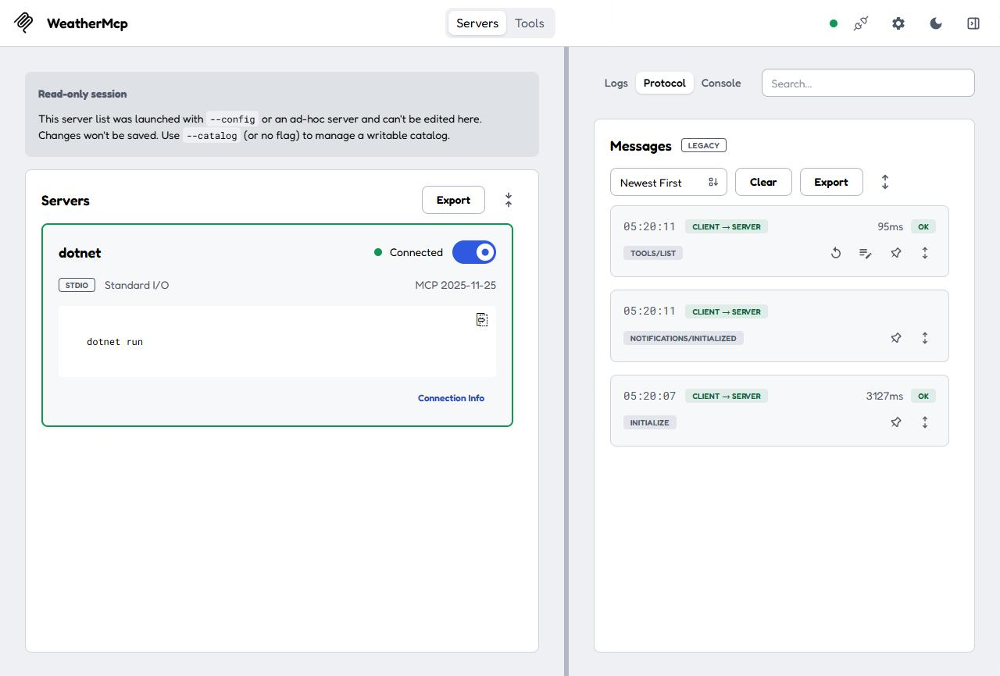
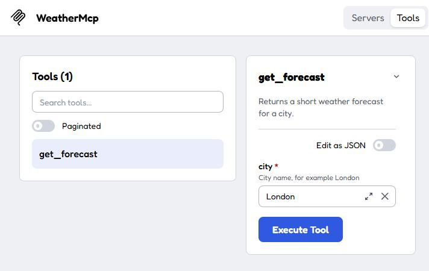
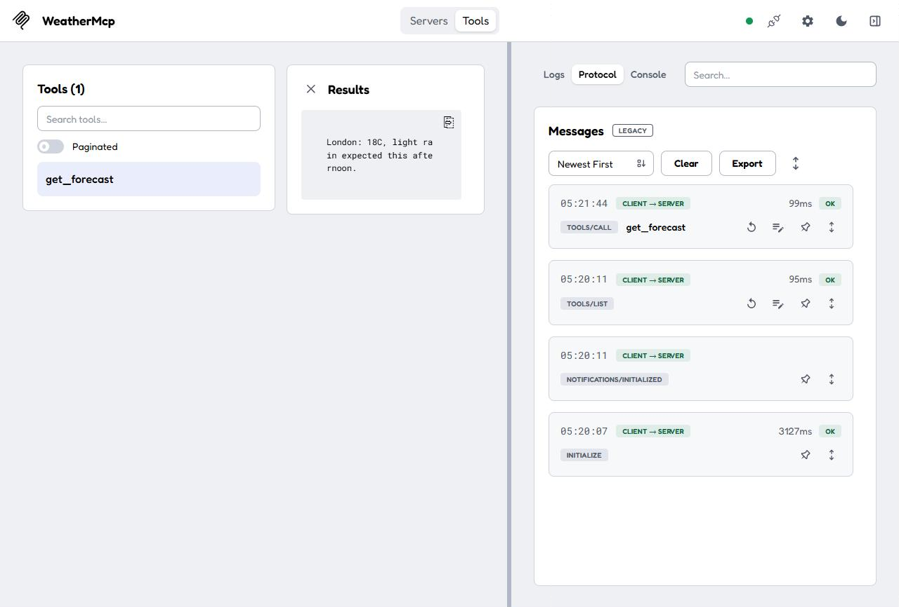
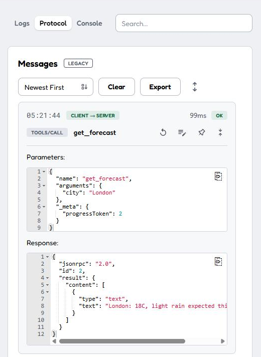

# MCP C# Weather Sample

This is a minimal [Model Context Protocol](https://modelcontextprotocol.io/) server written in C# with the official [`ModelContextProtocol`](https://www.nuget.org/packages/ModelContextProtocol) SDK. It exposes one tool, `get_forecast`, in two hosting styles:

| Project | Transport | Use it for |
|---|---|---|
| `WeatherMcp` | stdio | Local tools that a client starts as a child process (VS Code, Claude Desktop, MCP Inspector) |
| `WeatherMcp.Http` | Streamable HTTP | Shared tools that you host and scale like any ASP.NET Core service |

The weather data is a mock. The tool always returns the same canned forecast, so the sample stays focused on MCP itself.

Companion post: [Building an MCP Server in C# with the Official SDK](https://blogs.aravindmarri.com/net/mcp-server-csharp-sdk/)

## Prerequisites

- [.NET 10 SDK](https://dotnet.microsoft.com/download). The SDK package also targets .NET 8, .NET 9 and .NET Standard 2.0, but this sample was built and tested on .NET 10.
- Node.js, only if you want to use the MCP Inspector.

Tested with ModelContextProtocol 2.2.0, MCP Inspector 2.11.0 and .NET SDK 10.0.402.

## Run the stdio server with the MCP Inspector

```bash
cd WeatherMcp
npx @modelcontextprotocol/inspector@latest dotnet run
```

Open the URL the Inspector prints. In the Inspector:

1. Toggle the `dotnet` server on.
2. Open **Tools** and select `get_forecast`.
3. Enter a city and click **Execute Tool**.

Use `@latest`. Without it, `npx` can reuse an older, deprecated v1 Inspector from its cache.

The first connection takes a few seconds because `dotnet run` builds the project before the server can answer.

### What a successful run looks like

These screenshots are from a real run with Inspector 2.11.0.

The server connects over stdio. The Inspector negotiated protocol revision 2025-11-25, and the log shows the handshake:



The tool form is generated from the method signature and its `[Description]` attributes:



Executing the tool returns the mock forecast:



Expanding the `tools/call` entry shows the raw JSON-RPC request and response:



### Use it from VS Code

`.vscode/mcp.json` at the repository root registers the stdio server. The path is relative to the repository root, so open the root folder in VS Code.

## Run the HTTP server

```bash
cd WeatherMcp.Http
dotnet run
```

The server listens on `http://localhost:5113`, and `MapMcp()` maps the MCP endpoint at `/`. `WeatherMcp.Http.http` contains ready-to-send requests for both protocol revisions. Open it in Visual Studio, or in VS Code with the REST Client extension.

## Session modes (SDK 2.x)

The HTTP transport is stateless by default in SDK 2.x. These are the results from testing each mode against an older client (`initialize` with protocol 2025-11-25) and a current one (protocol 2026-07-28):

| `HttpServerSessionMode` | Older client (2025-11-25) | Current client (2026-07-28) |
|---|---|---|
| `Stateless` (default) | Works, no `Mcp-Session-Id` | Works |
| `Stateful` (what `Stateless = false` selects) | Gets a session | Rejected with error `-32022` |
| `StatefulForInitializeClients` | Gets a session | Works, served statelessly |

If older clients need sessions, use `StatefulForInitializeClients` rather than `Stateless = false`:

```csharp
builder.Services
    .AddMcpServer()
    .WithHttpTransport(options =>
        options.SessionMode = ModelContextProtocol.AspNetCore.HttpServerSessionMode.StatefulForInitializeClients)
    .WithToolsFromAssembly();
```

Stateless mode also has limits. The server can't send requests to the client, so sampling, elicitation and roots aren't available, and `GET`, `DELETE` and the legacy `/sse` endpoints are disabled.
